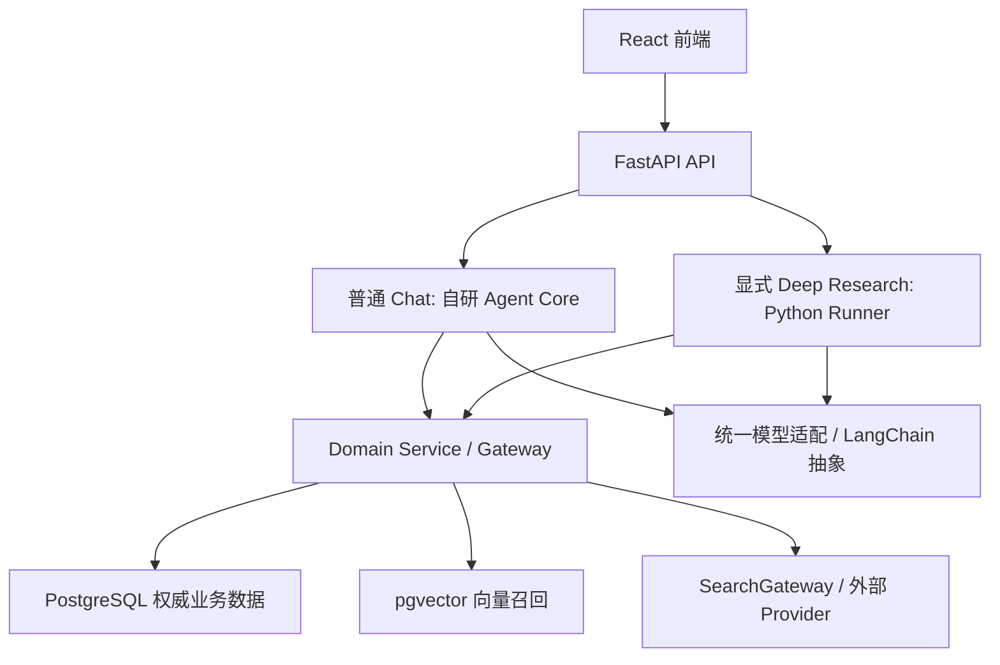

# 毕业答辩项目核心资料

论文题目：《基于AI大模型图书馆智能书籍管理系统设计与实现》

核验日期：2026-09-11。分支：`codex/search-deepresearch-quality`；HEAD：`9eae9aaf45a54267b09568034b63afcbf29ebd99`。最近生产修复包括 `054198d`、`283db47`，其后的当前分支提交主要为论文材料和截图。取证时有未跟踪的 `.codex-artifacts/`、`.codex-review/`、`backend/scripts/probe_book_search_owner.py`、截图 `browser_check/` 和 `thesis_run/`，未作为生产依据。

本资料根据生产入口、Service、ORM、前端请求、测试及 Git 差异整理。设计动机是对实现的解释；实测效果只报告本轮真正执行的验证。不把存在于仓库中的实验、兼容或独立运行模块直接等同于主链路。

路径约定：文中的 services/、infra/、api/ 和 models/ 相对于 backend/app/；测试文件相对于 backend/tests/。类名首次注明文件后可简称。

## 一、项目整体讲解

### 项目定义与价值

一句话定义：这是一个以自然语言为入口，将阅读状态管理、长期偏好记忆、个性化荐书和公开资料研究结合起来的个人智能阅读管理系统。

它解决三个连续问题：用户不愿反复填表记录阅读信息；跨会话的偏好和书架容易丢失；泛化书单无法结合已有阅读资产给出有取舍的建议。系统希望把“我正在读什么、怎么看这本书、下一本读什么”连接起来。

与传统图书管理系统的区别是交互与业务重心：当前主要面向个人阅读资产与智能服务，采用自然语言更新、版本化记忆和推荐。不要将论文题目扩展解释成已经完成馆藏采购、借还罚款、库存盘点和管理员审批；这些不是本次核验的主业务功能。

与普通“LLM聊天+API”的区别是执行闭环：模型形成结构化动作提议；系统验证动作、绑定当前用户、交给领域服务执行；系统记录真实结果回执；最终回复受回执约束。用户说“已经改好了”与数据库真的修改成功是两件事，项目通过这套闭环将它们连接起来。

### 功能与技术

| 模块 | 当前真实职责 | 关键位置 |
|---|---|---|
| 智能对话 | 会话、流式交互、结构化动作、受控发布 | `backend/app/api/v1/chat/run.py`；`services/agent_core/` |
| 阅读资产 | 想读/在读/已读/弃读，评价、备注、书架详情 | `backend/app/services/books/reading_service.py::ReadingService` |
| 长期记忆 | 当前事实、版本历史、修订、遗忘、实体关联 | `backend/app/services/memory/write_gateway.py::MemoryWriteGateway` |
| 查书与推荐 | lookup、推荐候选核验、个性化排序与排除 | `backend/app/services/books/recommendation_service.py::RecommendationService` |
| 普通 Search | 外部资料检索、融合和面向用户的综合 | `backend/app/services/external_search/gateway.py::SearchGateway.search` |
| Deep Research | 目标、补充检索、证据状态、审查与报告 | `backend/app/services/research/deep_research_runner.py::run_deep_research` |
| 配置与运行支撑 | 模型/Provider 配置、执行进度、错误、追踪 | `backend/app/infra/llm/factory.py`；前端 provider 配置组件 |

技术依据为 `frontend/package.json`、`backend/requirements.txt` 和实际 imports：React 19、TypeScript 5.9、Vite 8、Tailwind CSS 4；Python、FastAPI、Pydantic、SQLAlchemy 异步会话、asyncpg；LangChain、langchain-litellm、LangGraph 与 PostgreSQL Checkpoint/Store；PostgreSQL、pgvector；HTTP/SSE；Tavily、DDGS、AnySearch 搜索适配。这里只给依赖声明的主要版本，不把声明范围当成本机安装精确版本。

LiteLLM 使用的是进程内 SDK 适配方式：`infra/llm/factory.py::create_llm_from_config` 根据 Provider adapter、model ID、base URL 等构造聊天模型。没有据此证明系统部署了独立 LiteLLM Proxy 网关。模型服务生成回答，Embedding 模型生成向量，pgvector 保存和检索向量。

### 3～5分钟讲解稿

各位老师好，我的项目是基于大模型的智能书籍管理系统。它主要服务个人阅读管理，把阅读记录、长期偏好和下一本书的选择连接起来。传统系统通常让用户在不同页面填写状态和评价，我希望用户可以直接说：“我正在读这本书，觉得很好，备注是学习Python”，系统就能理解并执行相应操作。

系统采用前后端分离结构，前端使用React和TypeScript，后端使用FastAPI，PostgreSQL保存业务数据，pgvector辅助语义检索。模型与外部搜索服务通过统一适配层接入，便于切换服务商。

普通对话的核心是项目自研Agent Core。我把它分为Controller、Action和Receipt三个环节。Controller理解用户意图，提出结构化动作；系统检查动作是否合法，再交给业务Service执行；执行完成后形成回执，最后依据回执生成回复。因此，模型负责理解和建议，具体的数据修改和成功判断由系统负责。

一个关键设计是一次理解可以产生多个业务事实。例如同一句话包含阅读状态、评价和备注，系统会将这些信息合并到同一本书的更新中，而不是让多个模块分别理解原句，造成重复和遗漏。这里的一次理解并不是整个请求只允许调用一次模型，后续综合回答仍可能调用模型。

数据上，我区分书架、当前记忆和历史版本。书架是当前阅读资产的权威状态；长期记忆保存跨会话事实；版本链保留修订和遗忘过程；当前投影筛选仍然有效的事实。移出书架时，系统会同步撤销相应的当前阅读记忆，但保留历史。这样既能回答现在有什么，也能在明确查询历史时解释过去发生过什么。

推荐先形成候选，再结合外部资料核验、当前偏好、书架和行为信号排序。当前书架中的书不会作为未知新书重复推荐；已经移出书架的历史记录只作为排序信号，不永久禁止再次出现。这里采用可解释的规则评分，没有训练专门的推荐模型。

对于需要比较多个方向、核对多个来源的问题，用户可以显式开启Deep Research。它建立研究任务，围绕目标和证据缺口继续检索，由审查环节判断是否足够，并受到轮次和时间预算约束。最终发布材料按用户的决策需要组织，再由模型生成报告，避免把研究日志直接当答案。

项目的工程难点主要在于让模型理解、数据库状态和最终回复一致。我修复过备注传递遗漏、书架删除后当前记忆残留以及回复没有展示全部业务结果等问题，并通过回归测试验证。当前仍存在外部服务依赖、规则排序尚未经过用户实验、REST书架与派生记忆缺少自动补偿等不足。后续将重点完善一致性恢复和质量评测。谢谢各位老师。

## 二、系统总体架构

图中是依赖关系，不是每次请求必须依次访问全部组件。例如直接回答不一定查数据库或联网，外部模型也不是通过PostgreSQL调用。

**普通Chat核心编排是自研Agent Core，不是LangGraph。** `ChatService.invoke` 使用 `AgentChatEntry.run`，经过 `AgentControllerGateway.evaluate` 进入 `TurnControllerLoop.run`。SSE则由 `ChatStreamingService.generate` 转给 `TrustedControllerStream.generate`，同样进入Agent Core。`tests/test_production_agent_path.py` 对唯一生产入口及禁止旧运行时依赖设有约束。

Agent Core使用Controller—Action—Receipt：`ControllerClient.decide`产生决策；`AgentCoreHarness.run`调用`ProposalValidator.validate`、`WorkflowCompiler.compile`、`PlanGraphNormalizer.normalize`；`SystemRuntime.execute`执行；Receipt反馈给控制器或发布层。`TurnControllerLoop`最多6回合，包含直接回答、澄清、工具执行、后续综合等分支，不是无限自治Agent。

LangChain承担模型调用、消息、Runnable和工具协议相关抽象。它是基础库，不是业务权威。LiteLLM adapter处理不同Provider的协议与参数差异。

**LangGraph的准确口径：研究Harness中存在StateGraph，基础设施提供AsyncPostgresSaver/AsyncPostgresStore；当前界面显式Deep Research的主循环由Python Runner实现。** `research/harness/runtime.py::ResearchHarnessRuntime.__init__`构造planner、search_task_builder、source_visitor、aggregator、gap_filler、verifier、finalizer节点；`research/runtime.py::run_research_runtime`用调用方提供的observations运行此图。`chat.py`和`trusted_stream.py`显式模式却直接调用`run_deep_research_turn`，进而调用`run_deep_research`。不能因为仓库中有图就说每次Deep Research都执行此图；该图使用`graph.compile()`，也不能凭Checkpoint基础设施存在就宣称此图每个节点已自动持久化。

PostgreSQL保存关系状态、版本、行为和研究记录，是权威数据源。`infra/database/database.py::Database.session`采用成功提交、异常回滚、最终关闭会话的生命周期。pgvector只负责向量存储与相似度召回，不负责确定阅读状态、不执行推荐业务更新，也不生成Embedding；生成向量属于模型适配层。向量召回到的线索还需要经过当前版本读取边界。

## 三、4个最核心业务流程

### 1. 普通Chat执行流程

输入为文本、user/thread、模型选择等`UserInput`。`frontend/src/App.tsx`调用`frontend/src/lib/api.ts::streamChat`，POST `/api/v1/chat/stream`；浏览器使用fetch读取响应流，不是简单EventSource GET。

链路：API `stream`确认会话 → `ChatStreamingService.generate` → `TrustedControllerStream.generate` → 会话记录及模型解析 → `AgentChatEntry.run` → `AgentControllerGateway.evaluate` → `ControllerRequestBuilder.build`组装上下文 → `TurnControllerLoop.run` → Controller、Harness、SystemRuntime → 发布。

状态变化发生在会话日志、真正执行的领域动作及最终发布记录中。读取动作与修改动作必须区分。业务执行后模型可以继续综合；最终得到用户回复和业务回执，前端渲染进度/文本。发布涉及`agent_core/publication/service.py::TrustedPublisher`及`publication/commit.py`。

为什么这样设计：把模型不确定的决策和系统确定的执行分开，便于拒绝非法动作、追踪失败和控制回复。不这样做，模型可能声称“已保存”而数据库并没有成功写入。Receipt改善这一问题，但不等于所有网络断线都能自动恢复。

### 2. 一句话多事实理解与动作执行

演示输入：“把《Python编程：从入门到实践》设为在读，评价喜欢，备注学习python。”

Controller在同一语义批次提出0..N条`MemoryAssertionProposal`。`memory/turn_compiler.py::compiled_turn_from_assertions`把已理解的assertions转成`CompiledTurn/AtomicFact`，合并同书的状态、评价、备注；转换阶段不再次调用LLM。`MemoryWriteGateway.commit_compiled`分配阅读事实与其他事实，`_commit_reading`解析实体和校验canonical值，调用`ReadingService.upsert`。

状态变化：Shelf更新状态、评价、备注；阅读/反馈事件保留过程；阅读状态与评价经`record_reading_memory`形成派生版本；`reading_changes`把本次要求的维度交回发布层。备注的权威字段是Shelf.note，不能宣称它必定另有一条独立Memory备注事实。

最后由`publication/memory_renderer.py::render_memory_mutation`明确呈现状态、评价和备注。`test_effect_driven_reading.py::test_note_reaches_reading_service_and_user_visible_receipt`断言三条完整回复，即使Memory变更为空也保留实际Shelf结果。

为什么这样设计：避免各模块重复抽取、同书多事实相互覆盖、备注在适配中丢失。存在歧义时可以返回澄清或partial；不要宣称整个请求所有业务动作无条件全有或全无。版本批次校验和跨多个动作的事务不是同一个概念。

### 3. Shelf / Memory / CurrentProjection / Version Chain协同

| 概念 | 回答的问题 | 权威位置 |
|---|---|---|
| Shelf | 我现在有哪些阅读资产，状态、评价、备注是什么？ | `user_book_shelf`；ReadingService |
| Memory | 用户明确表达的跨会话事实是什么？ | `memory_events`及MemoryWriteGateway/MemoryReadGateway |
| Version Chain | 同一事实经历过什么修订和遗忘？ | chain_id、version_no、previous_version_id、operation等 |
| CurrentProjection | 历史和兼容结构中，当前应该给模型看什么？ | `MemoryVersionStore.list_current` + `collapse_semantic_current` |

写入入口不同，事务边界也不同：

- Chat阅读批次：`MemoryWriteGateway._commit_reading`使用同一个session调用ReadingService和记忆派生；领域动作的会话生命周期承担提交/回滚。
- REST新增/修改：`api/v1/books.py::upsert_bookshelf/update_bookshelf_entry`先完成Shelf会话，再await `write_reading_memory_best_effort`，后者使用独立session写Memory。
- 移出书架：`ReadingService.remove_entry`先以同session调用`MemoryWriteGateway.forget_reading_memory`，再delete Shelf；遗忘失败会阻止删除。这是当前一致性修复。

`MemoryVersionStore.commit`校验来源、排序并锁定memory keys、检查receipt复用和canonical hash；相同事实可noop，修订产生新版本。`forget`追加tombstone；`list_current`排除失效/遗忘记录，历史接口仍可查看版本。CurrentProjection还对旧命名链按语义槽收敛，例如同一宠物名字存在不同历史key时只暴露最新名称。它是代码投影，不是名为CurrentProjection的数据库表，也不是把全部历史重新总结一遍。

阅读记忆可视为长期记忆中的一个业务子域，但Shelf是独立的当前资产聚合。它们并非可互换的数据源。移出书架保留曾读历史；普通“推荐新书”以当前Shelf为硬约束，历史行为是软信号。手动遗忘Memory也不能推断成删除Shelf，两个用户操作语义不同。

当前不足：REST派生没有outbox自动补偿；helper名字虽有best_effort，但其内部无通用异常吞并，调用方也直接await。因此可能出现Shelf已提交、后续派生异常导致HTTP请求报错，不能保证“失败只记日志且总返回成功”。

### 4. 个性化推荐流程

输入例如“根据我的书架推荐不重复的新书”。`ControllerRequestBuilder._shelf_context`提供最多20条书架上下文，模型形成候选、主题、参考书、排除项等结构化请求。它不是完整排重的最终依据。

`RecommendationService.search`在recommendation模式读取偏好约束 → `_discover`调用`search_and_cache_books_with_status`发现/核验候选 → 过滤结构化限制和明确排除项 → `RecommendationProjector.project_books`读取完整当前Shelf、偏好与行为 → 排除、评分、排序 → 输出`BookEvidence` → 面向用户综合。

目录发现会缓存books，推荐投影还会通过`get_or_create_preference_profile`取得兼容偏好记录；因此不要说整个推荐链完全零写入。评分本身不训练模型。用户后续明确反馈会进入相应业务入口，阅读状态归ReadingService，行为信号归事件记录。

为什么这样设计：候选形成、业务约束、资料核验和语言呈现各有职责；工具搜索即使拿到了已有书，权威排重仍能兜住；外部web结果不能绕开RecommendationService直接变成个性化新书清单。

## 四、个性化推荐

### 候选与约束

候选不是单一SQL查询结果。Controller可给出`candidate_titles`，Service据此精确查书；不足时参考已给书目补充发现，也可以根据主题与有效query进行目录/外部搜索。`RecommendationService._discover/_discovery_queries`设有候选数、查询数和提前结束边界；并非所有发现查询都并行。

lookup用于查某本书或目录信息，不强制个性化排重；recommendation进入偏好约束和排序。因此“已有书不能再推荐为新书”不代表“系统不能再查到该书”。

当前Shelf硬排除是产品语义：想读、在读、已读、弃读都是用户已经知道的书，不能当未知新书返回。`RecommendationProjector._apply_shelf_state`设suppressed，`project_books`将它们放入suppressed_candidates。匹配先看book ID，再做标题与作品标题规范化；测试覆盖版本后缀。它不是全球完备的作品/译本身份库，仍可能误合并或漏合并。Shelf读取失败会抛出，不能把失败当空书架后假装排重成功。

### 偏好、历史与画像

`build_personalized_recommendation_constraints`从当前preference/correction记忆提取作者、主题、风格等，补充搜索词；书架中的正向条目可作为发现参照。`_load_preference_snapshot`优先当前Memory，各偏好桶缺失时读取`user_preference_profiles`补充。

所以“用户画像不是固定表”需要改成：主要画像是当前事实和行为的动态投影，但当前实现仍存在并实际读取固定结构的UserPreferenceProfile兼容表；不能说它不存在或完全没使用。空桶回退也有让旧偏好重新参与的风险，不能据此保证遗忘Memory后所有偏好来源均被清空。

历史读过/不喜欢某书会软降权，不会单独设置永久suppressed。这样用户移出书架、兴趣改变或重新考虑时仍有机会看到它。当前持续有效的明确风格规避是另一回事：命中disliked_tags会设置`avoided_style`并硬抑制；“所有负反馈一律软处理”不符合代码。

### Score实际含义

总分为`base_score + source_score + memory_score + behavior_score + query_score`，在`RecommendationProjector._project_book`计算并保留feature原因。

| 分项 | 当前规则 | 不能误讲成 |
|---|---|---|
| base | `max(0, 1 - rank_index * 0.05)`，原候选顺序先验 | 用户喜欢概率 |
| source | 本地缓存`min(0.25, 0.12 + max(0,match_score)*0.02)`；外部来源+0.05 | 经科学标定的来源真实性 |
| query | 最多8个词命中，`min(0.25, 0.04*命中数)` | 向量相似度模型 |
| memory | 喜欢标签+0.18、回避标签−0.35并抑制、喜欢作者+0.30、不喜欢作者−0.55 | 神经网络学习出的权重 |
| behavior | 阅读参照相似度、交互与推荐事件的加减分 | 所有历史永久排除 |

阅读参照按评价赋权，例如liked标签+0.22、同作者+0.30，disliked标签−0.10、同作者−0.15，总参照贡献限制在−0.3至+0.6。计入behavior_score。

RecommendationEvent的时间衰减为`0.5^(age_days/30)`，默认半衰期30天；BookInteraction的固定增减分没有同样的时间衰减。历史read事件基础为−1，liked为strength×0.55后衰减；旧interaction的read为−1、like为+0.5。两个来源可能累计同一行为的影响，当前没有充分证据说明已完成跨事件去重或评分标定。

当前没有在此推荐链中训练协同过滤、矩阵分解或深度推荐模型。准确说法是“大模型理解与候选建议＋公开资料核验＋可解释规则排序”。原因是个人数据量少、冷启动明显、需要可追踪；这属于设计取舍，不能拿它证明效果优于训练模型。离线排序指标、长期用户满意度实验尚未确认。

## 五、Deep Research

### 真实主链路

前端`chat-main-panel.tsx`维护researchMode开关，`App.tsx`发送`research_mode=deep_research`。后端Chat/SSE入口显式分支进入`run_deep_research_turn`。开启深度思考thinking_mode不等于开启Deep Research。

| 阶段 | 实际职责与出处 |
|---|---|
| ResearchRun | `run_deep_research`通过orchestrator.start_research先建立持久任务，再启动规划异步任务，避免先启动后无任务归属 |
| 目标规划 | `objective_planner.py::plan_research_objective`产生计划、候选假设、关键问题；结构化解析失败保留失败原因和受限fallback |
| 子问题与检索 | `_plan_next_task/_enqueue_subquestions`维护待查前沿；`_execute_search_task`与asyncio.gather执行有界并行来源/候选检索 |
| Evidence | 来源清洗、质量判断、断言抽取、准入；`_admit_round_evidence`进入研究证据体系 |
| Known Facts/Gaps/Conflicts | orchestrator.update_research_state保存状态；字段主要在research_state_snapshots，并非全塞在research_runs |
| Reviewer | `reviewer.py::review_research_state`评估sufficient/insufficient/budget_exhausted和next_subquestions，结合确定性质量门槛 |
| Budget/Stop | 最大搜索批次、总时间、重复查询与信息增益检查；证据足够或预算用完停止 |
| PublicationPacket | `build_research_publication_packet`把用户目标、候选判断、证据索引、关键限制和冲突交给写作模型 |
| 最终报告 | `write_research_report`面向用户生成Markdown，检查引用/安全与回答质量，允许有界修复与回退 |

规划与首轮检索有重叠执行，以上是职责顺序，不是所有阶段必须严格串行等待的时序图。Reviewer是模型调用加规则验证，不是人类专家，也不是数学证明器。

### 停止条件与边界

`deep_research_runner.py`当前初始化`max_search_rounds=4`，总预算常量360秒，预留110秒发布；检查acquisition deadline，不让搜索挤掉最终回答。重复查询集合、连续两批无新增可发布证据等检查用于避免空转。报告写作还有自己的60秒调用和45秒修复超时。这里描述的是实现的预算机制，不承诺每种网络/取消异常下端到端绝对不超过360秒。

与普通Chat分开的原因是资源与状态不同：普通Chat重在快速理解和执行；研究需要跨来源比较、记录缺口、进行多次取证。显式开启使用户知晓更长等待和更多模型/搜索消耗，也避免日常问题自动进入昂贵研究。默认研究不读取个人Memory/Shelf；普通个性化推荐的排重逻辑不能自动套到所有研究报告上。依据`test_effect_driven_reading.py::test_default_report_does_not_read_personal_memory`。

搜索结果不能直接成为答案，因为网页可能是目录页、广告、作者简介、转载或与问题无关的摘要；找到候选不等于推荐理由成立。研究还要比较适用人群、证据缺口与取舍。另一方面，外部证据缺少也不应抹掉模型已有的稳定知识：Packet显式保留model_rationale、expected_fit、model_tradeoffs，并区分允许的候选和externally_verified_entities；缺证据要披露，不能伪装成已验证事实。

Publication safety与answer quality分开：空输出、虚构URL、内部推理泄漏等属安全边界；覆盖不足、格式不佳、缺少比较属于回答质量。当前测试要求不能仅因章节或数量形式不合格就让安全答案无法发布。但还存在来源/候选准入和失败回退，不能承诺任何问题、任何模型都生成丰富报告。

LangGraph在独立ResearchHarness中负责节点状态流转；当前显式生产Runner的循环和状态持久化由Python与应用研究服务负责。Checkpoint/Store是已接入的基础设施，不等于此主链路已实现任意节点崩溃自动续跑。队列式持久Worker及端到端自动恢复能力未确认。

## 六、数据库设计

字段取自`backend/app/models/user.py、chat.py、book.py、memory.py、research.py`。下表是核心实体职责，不是完整数据库字段表。

| 表 / ORM类 | 主键及关键字段 | 职责与关系 |
|---|---|---|
| users / User | id；display_name、is_mock_user | 用户身份；1:N会话、书架、记忆、推荐事件、研究任务 |
| conversations / Conversation | thread_id；user_id、title、is_deleted、journal_sequence、token计数 | 会话元信息；user_id外键→users.id；不是消息正文表 |
| books / Book | id；title、authors、tags、summary、rating、source_url、raw_data | 公共书目缓存；不是用户阅读状态表 |
| user_book_shelf / UserBookShelf | id；user_id、可空book_id、title、reading_status、evaluation、note、rating | 当前阅读资产；用户与书通过它形成业务M:N；书目未解析时可无book_id |
| memory_entities / MemoryEntityRecord | id；user_id、entity_type、canonical_name、aliases、external_ref | 用户范围稳定实体标识；1:N关联记忆事实；external_ref是JSON，不能画成books的真实FK |
| memory_events / MemoryEventRecord | id；user_id、entity_id、chain_id、memory_key、version_no、operation、previous_version_id、valid_from/to | 当前有效头与历史版本共处同表；self-FK连接版本；修订、遗忘保留历史 |
| recommendation_events / RecommendationEvent | id；user_id、可空book_id/thread_id、event_type、signal_polarity、signal_strength、metadata | 行为信号、阅读/评价事件；不是当前书架快照 |
| research_runs / ResearchRunRecord | id；user_id、thread_id、objective、status、budget、stop_criteria | 研究任务归属和生命周期；1:N步骤、证据 |
| research_steps / ResearchStepRecord | id；run_id、step_type、status、input/output、error、duration_ms | 研究动作记录；run_id FK；1:N关联证据 |
| research_evidence / ResearchEvidenceRecord | id；run_id、可空step_id、source_url、claim、excerpt、quality、relevance | 研究来源与断言；不是永久用户偏好 |

必要补充但不扩展成全库讲解：`conversation_events`保存消息/事件；`research_state_snapshots`保存known_facts/gaps/conflicts；`user_preference_profiles`是推荐兼容偏好源；`book_interactions`是历史行为源；`user_bookshelf_state`标记历史回填已完成。不能为满足“只讲十张表”而谎称这些职责在十张表内。

关系基数说明：books到Shelf为1:N，users到Shelf为1:N；由两条关系表达用户与书的M:N。memory_entities到memory_events为1:N但entity_id可空；研究任务到步骤/证据为1:N，证据可以没有step。conversations主键是thread_id，不要在E-R图中写成不存在的id。books被删除时可空引用SET NULL，相关书名仍可保留；用户相关FK常用CASCADE，具体以模型声明为准。

不能全塞进Memory表的原因：当前状态需要确定读写，历史版本需要追踪，行为需要聚合衰减，研究材料需要按任务组织。混为一表会让“曾经读过”与“现在在书架”混淆，公共网页事实与用户偏好混淆，也使外键、状态约束、查询和删除语义难以表达。使用同一个PostgreSQL并不要求使用同一种数据模型。

## 七、真实踩坑与解决方案

以下9项均有代码/测试或Git证据。测试证明的是被测试行为；没有逐次线上故障录像的条目，不虚构发生日期和影响用户数。

### 1. 同句多事实与备注遗漏

问题现象 → 状态和评价可更新，备注未进入最终结果。

根因 → 旧编译适配仅保留reading_status/evaluation，字段在层间传递时丢失。

原方案 → 状态/评价断言转换后交给Reading。

为什么不行 → 即使模型理解了note，系统未透传仍无法落库。

最终方案 → 同书断言合并保留note，Gateway传给ReadingService，再携带reading_changes。

为什么有效 → 覆盖“模型断言→Service参数→最终回执”整条链，不只是修改提示词。

当前不足 → 模型未提取、实体歧义或跨书理解错误仍可能发生。

代码证据 → `054198d`对`memory/turn_compiler.py::compiled_turn_from_assertions`与`write_gateway.py::_commit_reading`的修改；`test_effect_driven_reading.py::test_note_reaches_reading_service_and_user_visible_receipt`。

30秒讲法 → “我发现问题并不总在模型。备注已经被理解，但中间协议没有保留。后来我补齐断言、业务参数和回执三层的数据契约，并用测试验证三项同时到达最终回复。”

### 2. 书架删除后当前记忆残留

问题现象 → 书架已移除，当前记忆还说正在阅读。

根因 → 原remove_entry只删除Shelf行。

原方案 → Reading写后派生Memory，但删除没有对应撤销。

为什么不行 → 单向同步无法处理撤销，两个界面相互矛盾。

最终方案 → 同事务追加该书阅读记忆tombstone，再删除Shelf。

为什么有效 → 遗忘失败则不删除书架，成功则两个当前视图一起退出，历史仍保留。

当前不足 → REST新增/修改仍是两阶段派生，不具备同等原子性。

代码证据 → `054198d`；`ReadingService.remove_entry`；测试`test_shelf_delete_and_memory_forget_share_one_service_transaction`、`test_failed_memory_forget_does_not_delete_shelf_row`。

30秒讲法 → “删除不是把历史全抹掉。我让当前书架删除和当前阅读记忆失效在同一事务完成，历史版本继续保留，这样当前状态一致，过去记录也能解释。”

### 3. 回复与实际多项业务结果不一致

问题现象 → 实际处理多个阅读维度，回复却只说记住了或漏掉状态/评价。

根因 → 发布主要围绕Memory mutation，重复事实noop时无法代表Shelf变化。

原方案 → 由Memory版本变更生成确认文案。

为什么不行 → Memory没有新版本不等于Shelf没有应展示的操作结果。

最终方案 → 传递typed reading_changes，逐项展示状态、评价、备注，去掉重复派生文案。

为什么有效 → 发布依据本次真实业务结果，不再从Memory变化数量猜测成功项。

当前不足 → 网络中断仍可能让用户看不到已提交结果；不能声称exactly-once交付。

代码证据 → `283db47`；`publication/memory_renderer.py::render_memory_mutation/_render_shelf_reading_changes`；上述备注回执测试。

30秒讲法 → “我把成功回复从‘记忆有没有新增’改成‘本次业务究竟做了什么’，即使状态是重复设置，也能准确确认状态、评价和备注。”

### 4. 当前事实和旧命名事实混淆

问题现象 → 同一对象更名后，旧结构或旧summary仍可能进入上下文。

根因 → 兼容历史里同一个命名语义槽可能对应多条物理key。

原方案 → 逐key取当前头。

为什么不行 → 物理当前头不一定等于语义上唯一的当前事实。

最终方案 → `collapse_semantic_current`收敛语义槽，兼容投影去掉旧名称描述；历史查询保留链。

为什么有效 → 读侧统一当前事实，同时不破坏历史数据。

当前不足 → 当前兼容收敛重点在命名槽，不是任意自然语言矛盾的通用解算器。

代码证据 → `memory/current_projection.py`；`MemoryReadGateway.current_versions/history_versions_by_key`；`test_memory_versioning.py`命名与实体相关测试。

30秒讲法 → “同一件事可能因为旧协议落在不同key，逐key取最新还会冲突。我增加语义投影，让模型只看到当前名称，而审计仍能查看过去名称。”

### 5. 推荐已有书、缺少书架上下文

问题现象 → 用户要求根据书架荐书，模型没有具体书目，或返回版本变体当新书。

根因 → 决策上下文不足；搜索结果不是权威书架集合。

原方案 → 推荐决策缺少现在的有界Shelf上下文和具体正向书目参照，更多依赖偏好/文本query。核对5ebe047发现该基线已包含全部Shelf状态排除，不能把这一已有机制虚构成054198d才新增。

为什么不行 → 排除机制能去掉已有书，却不能替代模型对具体书架的理解；缺少上下文会影响“根据我的书架”的候选形成。

最终方案 → Controller获得有界Shelf；Service使用正向书目发现；Projector加载当前Shelf硬排除并规范化作品标题。

为什么有效 → 同时改善候选形成与最终业务过滤。

当前不足 → 作品身份规范化不是完整书目权威库。

代码证据 → `054198d`；`ControllerRequestBuilder._shelf_context`、`RecommendationProjector._apply_shelf_state`；`test_every_authoritative_shelf_status_is_not_a_new_recommendation`及版本变体测试。

30秒讲法 → “我把‘让模型知道书架’与‘系统确保不重复’分开。前者帮助理解，后者由完整书架做硬过滤，不能互相代替。”

### 6. 搜索来源失败拖垮整体

问题现象 → 单一Provider不可用，或一个慢Provider影响最终等待。

根因 → 外部服务错误、超时和空结果是不同情况。

原方案 → 当前兼容failover按序执行，单一路径容易受服务质量影响；这里不虚构某次线上具体失败日志。

为什么不行 → 任一失败直接中止会丢掉其他可用来源，等待所有来源又浪费时间。

最终方案 → SearchGateway统一failover/federated策略、deadline、短暂补充等待、去重和错误状态。

为什么有效 → 完整快结果可先返回，其他Provider失败以warning保留，empty与unavailable可区分。

当前不足 → 所有来源同时不可用仍会失败；URL去重不等于来源独立。

代码证据 → `external_search/gateway.py::SearchGateway.search/_search_federated`；`test_external_search.py`的failover、fast_success、provider_failure_as_warning测试。

30秒讲法 → “外部服务不可控，所以我把失败与空结果分开，并让统一网关选择切换或并行融合。这样一个Provider出错不会自动变成整个搜索失败。”

### 7. 研究循环提前自认为足够或无增益继续搜索

问题现象 → 低质量线索满足了循环条件，却无法通过最终证据准入；继续查询又没有增加材料。

根因 → 研究停止与最终发布采用不同证据门槛，数量替代质量。

原方案 → 以粗粒度证据数量/轮次衡量充分性。

为什么不行 → 同一份材料会在两个阶段得到冲突判断。

最终方案 → 统一质量要求、Reviewer结合缺口、记录新增可发布证据量，限制轮数与时间。

为什么有效 → 把停止条件关联到可用信息及剩余预算。

当前不足 → Reviewer判断仍依赖模型，预算耗尽可返回部分结论，completed不等于完全研究透。

代码证据 → `deep_research_runner.py::run_deep_research`、`reviewer.py::_validate_review`；`test_research_loop_quality.py::test_low_quality_lead_does_not_stop_medium_quality_research`和`test_medium_quality_candidate_uses_same_threshold_as_final_verifier`。

30秒讲法 → “找到很多页面不代表问题解决。我把研究充分性与最终可用证据统一，还加了无增益和时间预算停止，避免既搜不深又一直搜。”

### 8. 发布压缩丢候选、格式检查替代质量

问题现象 → 候选已找到，综合却只剩少数；格式偏差导致可用答案被拒。

根因 → 发布输入按内部研究状态组织，形式校验混淆内容质量和安全。

原方案 → 扁平证据及固定报告形态约束。

为什么不行 → 难以保留每个候选的理由与取舍，缺少用户目标约束。

最终方案 → PublicationPacket按候选/证据维度保存模型判断，用户brief指明任务；拆分安全与质量，提供有界修复与覆盖补充。

为什么有效 → 写作模型得到决策材料，安全答案不会仅因固定Markdown结构缺失而被阻断。

当前不足 → 上下文截断、候选上限和模型综合能力仍约束最终深度。

代码证据 → `f039f06`；`research/publication/packet.py::build_research_publication_packet`、`report_writer.py::write_research_report`；`test_response_presentation_architecture.py`的packet、quality_axes、format_and_breadth测试。

30秒讲法 → “我后来把最终回答当作给用户做决策的产品，而不只是研究日志摘要。材料保留候选判断、证据和缺口，安全检查与内容质量分开。”

### 9. REST派生一致性与旧文档过度保证

问题现象 → 代码允许Shelf提交后再派生Memory，旧契约说失败只记录日志。

根因 → 事务已经分开，而helper名称和文档给出比实际异常处理更强的承诺。

原方案 → POST/PATCH提交后await best_effort派生。

为什么不行 → 后续异常不会撤销Shelf，还可能让接口返回错误；无outbox无法自动保证重试恢复。

最终方案 → 当前已落实统一Gateway入口与删除同事务；新增/修改的自动补偿尚未解决，本轮仅记录，不宣称完成修复。

为什么有效 → 统一入口能防止绕过版本协议，但不解决跨事务原子性。

当前不足 → 缺少持久派生任务、重试和幂等补偿的闭环。

代码证据 → `api/v1/books.py::upsert_bookshelf/update_bookshelf_entry`、`reading_service.py::write_reading_memory_best_effort`、`docs/bookshelf-contract.md`事务说明。

30秒讲法 → “这是当前真实不足：书架是权威状态，派生记忆独立提交。删除已做到原子撤销，但新增修改还需要outbox补偿，不能把函数名字当成一致性保证。”

## 八、答辩高频问题

### 1. 为什么做这个系统？

【老师问题】传统书架已经能记录，为什么还需要大模型？

【30秒回答】用户可以用自然语言表达多个阅读信息，系统把它们转成业务操作，并在后续推荐中复用偏好和阅读资产，减少重复输入。

【如果继续追问怎么答】展示一句话状态＋评价＋备注，再打开书架验证；长期记忆用于后续跨会话服务。

【对应代码位置】`ReadingService.upsert`；`MemoryWriteGateway._commit_reading`。

【容易答错的点】不要声称已完成传统图书馆全部借还管理。

### 2. 创新点是什么？

【老师问题】你的创新体现在哪里？

【30秒回答】主要是工程设计：多事实受控执行、当前状态与历史分离、回执约束回复、个性化过滤和独立研究链的结合。

【如果继续追问怎么答】创新不是发明大模型或新算法，而是面向阅读业务建立可验证的执行闭环；效果优势需实验支持。

【对应代码位置】`AgentCoreHarness.run`；`MemoryVersionStore.commit`；`RecommendationProjector.project_books`。

【容易答错的点】不要说训练了自己的大模型或首创了Agent。

### 3. 为什么不是简单API套壳？

【老师问题】除了调用大模型，你做了什么？

【30秒回答】系统管理真实业务状态、版本、外部证据与执行回执。模型不能直接决定数据库修改成功，必须经过验证、Service和发布。

【如果继续追问怎么答】用“模型说已保存，但事务失败”解释为什么需要Receipt和事务边界。

【对应代码位置】`AgentCoreHarness.run`；`SystemRuntime.execute`；`TrustedPublisher`。

【容易答错的点】不要只列框架名称。

### 4. 为什么不能让LLM直接写数据库？

【老师问题】让它生成SQL不是更简单吗？

【30秒回答】SQL可能涉及错误用户、越权字段和不可控副作用。当前让模型提出业务动作，系统绑定身份、校验协议、执行业务更新。

【如果继续追问怎么答】记忆key、版本、receipt等存储标识由系统管理；证据须符合来源协议。

【对应代码位置】`ProposalValidator.validate`；`MemoryVersionStore._require_user_source/commit`。

【容易答错的点】这些控制不等于整个HTTP鉴权体系已通过安全审计。

### 5. Agent Core具体是什么？

【老师问题】它与工具调用有什么区别？

【30秒回答】它是Controller—Action—Receipt控制循环，负责将模型决策编译为合法动作、执行并反馈结果，工具调用只是其中一环。

【如果继续追问怎么答】解释Validator、Compiler、Runtime、Publisher各自职责，以及最多6回合。

【对应代码位置】`TurnControllerLoop.run`；`AgentCoreHarness.run`。

【容易答错的点】不要把它说成完全自主、无限运行的智能体。

### 6. 为什么普通Chat不用LangGraph？

【老师问题】既然引入了LangGraph，为什么还自研？

【30秒回答】普通Chat需要明确的业务动作与回执边界，当前用项目控制循环实现这套契约。研究Harness和持久化基础设施仍使用LangGraph相关组件。

【如果继续追问怎么答】这是控制边界和现有实现选择，不表示LangGraph做不到；解释实际调用入口。

【对应代码位置】`chat.py::ChatService.invoke`；`agent_core/turn_loop.py`；`research/harness/runtime.py`。

【容易答错的点】不要说所有Agent均由LangGraph驱动。

### 7. 一次理解是不是只调用一次模型？

【老师问题】为什么代码里还有循环？

【30秒回答】一次理解指同一用户事实不让多个Service重复抽取。后续可以根据回执继续决策或生成综合回答，循环有上限。

【如果继续追问怎么答】普通推荐决策和综合是不同职责；`compiled_turn_from_assertions`不再调用模型。

【对应代码位置】`memory/turn_compiler.py::compiled_turn_from_assertions`；`TurnControllerLoop`。

【容易答错的点】不要承诺所有请求恰好一次或两次模型调用。

### 8. 一句话两本书怎么处理？

【老师问题】如何避免只处理第一本？

【30秒回答】Controller输出多条原子事实，同书不同维度合并，不同书保留独立条目，Gateway逐项交给ReadingService。

【如果继续追问怎么答】展示多书批次测试；歧义条目可以澄清，不能凭关键词制造写入。

【对应代码位置】`compiled_turn_from_assertions`；`test_one_controller_batch_projects_multiple_books_and_dimensions`。

【容易答错的点】不要把部分澄清说成全批次必然失败。

### 9. Shelf和Memory为什么分开？

【老师问题】书架不是记忆的一部分吗？

【30秒回答】概念上阅读是长期信息的一部分，但数据库职责不同。Shelf保存当前资产；Memory保存跨会话事实及版本，历史不能替代当前书架。

【如果继续追问怎么答】删除书架但保留历史是最直观例子。

【对应代码位置】`UserBookShelf`；`ReadingService.remove_entry`；`MemoryWriteGateway.forget_reading_memory`。

【容易答错的点】不要说二者完全无关，也不要说互为完整镜像。

### 10. CurrentProjection是什么？

【老师问题】它是新表还是缓存？

【30秒回答】它是读侧当前事实投影：版本Store选当前有效记录，兼容投影收敛重复命名槽，输出当前可信事实。

【如果继续追问怎么答】当前头是物理概念，当前名称是语义概念；历史保留但不默认注入。

【对应代码位置】`MemoryVersionStore.list_current`；`collapse_semantic_current`。

【容易答错的点】不是自动化解任意冲突的通用知识图谱。

### 11. 改名与遗忘怎么实现？

【老师问题】旧值会被覆盖吗？

【30秒回答】修订新增版本并关联前版；遗忘追加tombstone，使事实退出当前读取。历史查询仍能看到过程。

【如果继续追问怎么答】实体ID稳定，名字可以变；相同hash可以noop避免重复版本。

【对应代码位置】`MemoryVersionStore.commit/forget`；`MemoryEntityRecord`。

【容易答错的点】业务遗忘不是所有备份与历史的物理擦除。

### 12. 删除书架后还会推荐这本书吗？

【老师问题】之前不是说读过就不重复推荐吗？

【30秒回答】当前Shelf中的书硬排除，移出后历史阅读信号只降权，所以仍可能再次推荐。系统不能把它永远描述成从未读过。

【如果继续追问怎么答】当前策略既不是无条件立即推荐，也不是历史永久排除；是当前排除加历史排序。

【对应代码位置】`RecommendationProjector._apply_shelf_state/_apply_behavior_features`。

【容易答错的点】“所有曾读书永不推荐”不符合当前实现。

### 13. pgvector做什么？

【老师问题】为什么普通数据库不够？

【30秒回答】关系数据库适合准确状态和约束；pgvector补充语义相似检索，帮助找到表达不同但相关的记忆线索。

【如果继续追问怎么答】Embedding由模型生成，检索结果再经过当前事实读取，不能把相似度当事实真实性。

【对应代码位置】`infra/database/vectorstore.py::PGVectorVectorstore`；`memory/version_search.py`。

【容易答错的点】不是pgvector生成向量，也不是所有推荐评分都来自向量。

### 14. 推荐候选从哪来？

【老师问题】书籍都是数据库预置的吗？

【30秒回答】可以由模型提出候选，再通过目录和外部来源核验，也可以按query搜索发现并缓存。用户书架和偏好影响发现方向。

【如果继续追问怎么答】区分candidate_titles、reference_titles与excluded_titles，参考书可以引导发现但不能冒充新候选。

【对应代码位置】`RecommendationService._discover/_discovery_queries`。

【容易答错的点】不是全量馆藏数据库，也不是模型编造书目直接入选。

### 15. 如何个性化？

【老师问题】两个人输入相同问题结果为什么不同？

【30秒回答】当前偏好、已有书架、阅读参照及行为信号不同，会影响query、过滤和排序，模型也得到部分用户上下文。

【如果继续追问怎么答】解释五个score分项和suppressed集合；非确定模型输出不保证每次相同。

【对应代码位置】`build_personalized_recommendation_constraints`；`RecommendationProjector.project_books`。

【容易答错的点】Score不是喜欢概率。

### 16. 用户画像有固定表吗？

【老师问题】画像放在哪里？

【30秒回答】主要从当前Memory和行为动态构建，但当前还保留user_preference_profiles并按空偏好桶回退读取。

【如果继续追问怎么答】这是兼容机制，后续需要处理旧偏好与遗忘语义的一致性。

【对应代码位置】`UserPreferenceProfile`；`RecommendationProjector._load_preference_snapshot`。

【容易答错的点】不要说固定画像表不存在或已经完全废弃。

### 17. 为什么没有训练推荐模型？

【老师问题】规则评分是不是太简单？

【30秒回答】目前数据量与项目范围更适合可解释规则加大模型候选，便于冷启动和验证。它有局限，未来需用真实反馈评测后再考虑训练模型。

【如果继续追问怎么答】训练需要样本、负采样、数据划分、离线指标与用户实验，不能仅换算法就宣称更好。

【对应代码位置】`recommendation_projection.py`中的固定权重与score计算。

【容易答错的点】不能把大模型预训练等同于本项目训练推荐模型。

### 18. 负反馈如何使用？

【老师问题】不喜欢一本书就永远不推荐这类书吗？

【30秒回答】单书历史反馈和相似阅读参照通常降权；当前明确风格回避命中可硬抑制；Shelf已知书另行排除。

【如果继续追问怎么答】推荐事件默认30天半衰期，但旧BookInteraction不衰减；当前机制并不完全一致。

【对应代码位置】`_apply_memory_features/_apply_reading_anchors/_apply_behavior_features`。

【容易答错的点】不要说所有负反馈都硬排除或所有信号都衰减。

### 19. Deep Research与普通Chat/Search差在哪？

【老师问题】是不是多搜几轮？

【30秒回答】研究持久保存目标、证据、缺口和审查状态，根据缺口选择下一步；普通Search重在一次检索增强后的快速综合。

【如果继续追问怎么答】4轮是安全上限，不是强制做满；信息已充分可以提前结束。

【对应代码位置】`run_deep_research`；`review_research_state`；`SearchGateway.search`。

【容易答错的点】不能说深度模式必然更准确或必然完成所有目标。

### 20. 为什么显式开启研究？

【老师问题】让模型自动决定不更智能吗？

【30秒回答】研究会增加等待、调用成本和外部检索，显式模式让用户控制投入，也让日常对话保持轻量。

【如果继续追问怎么答】前端researchMode转为请求research_mode，后端分支执行；思考开关是另一个参数。

【对应代码位置】`frontend/src/App.tsx`；`TrustedControllerStream.generate`。

【容易答错的点】不要混淆thinking_mode与research_mode。

### 21. 如何避免无限研究？

【老师问题】模型一直说证据不足怎么办？

【30秒回答】最多4个搜索批次，设置总时间与发布预留，记录重复查询和信息增益，预算耗尽后用已有材料说明限制。

【如果继续追问怎么答】当前常量360秒、发布预留110秒；这些是控制预算，仍需要运行监控和异常处理。

【对应代码位置】`deep_research_runner.py::run_deep_research`。

【容易答错的点】不是只靠Prompt让模型自己停。

### 22. 如何防止幻觉？

【老师问题】有引用就一定是真的吗？

【30秒回答】引用、准入、协议和来源检查降低错误风险，但不能消除幻觉；来源本身可能有误，模型也可能误解，报告需要标出不确定性。

【如果继续追问怎么答】区分模型稳定知识判断、外部核验事实与未覆盖缺口；不能给未检索事实伪造引用。

【对应代码位置】`ResearchPublicationPacket`；`publication/policy.py::validate_synthesis`；`write_research_report`。

【容易答错的点】不要说系统100%可靠或Reviewer保证真实。

### 23. 数据库为什么这样设计？

【老师问题】为什么不用一张JSON表？

【30秒回答】用户、会话、资产、事实版本、行为和研究的生命周期不同，关系与外键明确后才能准确查询、更新和追踪。

【如果继续追问怎么答】Shelf是当前资产，memory_events混合当前头与历史，research_state_snapshots记录研究过程状态。

【对应代码位置】`backend/app/models/book.py、memory.py、research.py`。

【容易答错的点】不能把JSONB等同于无结构，也不能把conversations当消息正文表。

### 24. 怎么证明项目确实解决了问题？

【老师问题】只有截图够吗？

【30秒回答】用同一演示输入核对Chat回复、Shelf字段和当前记忆，再用回归测试验证协议边界。本轮所选测试118项通过，另有4个subtests。

【如果继续追问怎么答】说明这些是离线单元/契约测试，不代表线上模型成功率；还需要真实运行和质量评测。

【对应代码位置】`test_effect_driven_reading.py`、`test_external_search.py`、`test_response_presentation_architecture.py`。

【容易答错的点】不要把测试通过率当推荐准确率。

### 25. 最难的问题是什么？

【老师问题】能讲一个真实修复吗？

【30秒回答】一次阅读操作需要状态、评价、备注都成功呈现。模型理解后中间协议曾丢备注，Memory重复又让回复缺项；后来补齐字段传递和reading_changes回执。

【如果继续追问怎么答】打开054198d和283db47差异，展示参数断言及三行回复测试。

【对应代码位置】`compiled_turn_from_assertions`；`render_memory_mutation`；上述两个提交。

【容易答错的点】不要只说“我优化了Prompt”。

### 26. 当前最大不足和改进方向？

【老师问题】如果继续做，你优先改什么？

【30秒回答】先补REST派生记忆的持久重试与一致性恢复，再做推荐质量评测和行为去重，完善研究失败恢复及模型兼容测试。

【如果继续追问怎么答】基于Shelf已提交而Memory失败的具体场景解释outbox：同事务记录待派生事件，再由可重试消费者处理。

【对应代码位置】`api/v1/books.py::upsert_bookshelf`；`write_reading_memory_best_effort`；`RecommendationProjector`；`run_deep_research`。

【容易答错的点】outbox是改进建议，当前未实现，不能说已经有。

### 答辩速查表（一页内容）

| 项目 | 速记 |
|---|---|
| 一句话 | 自然语言驱动的个人阅读资产、长期偏好与智能荐书/研究系统 |
| 核心架构 | React → FastAPI → 自研Controller—Action—Receipt → Domain Service → PostgreSQL；pgvector辅助召回；模型/搜索独立适配 |
| 4个流程 | Chat理解—执行—回执—发布；多事实合并—Reading更新；Shelf当前—Memory派生—版本保留—当前投影；候选发现—当前Shelf排除—偏好行为排序—综合 |
| 5个亮点 | 多事实单次理解；副作用受控；当前/历史分离；可解释个性化约束；研究与用户报告分工 |
| 5个真实踩坑 | note被适配丢失；删Shelf留当前Memory；noop导致回复漏项；旧命名key冲突；已有书/版本变体重复推荐 |
| 5个不足 | REST派生无outbox；规则权重无效果标定；兼容行为重复计分/衰减不一致；外部来源和模型不稳定；研究可靠后台恢复未确认 |
| 10个危险追问 | 是API套壳吗？一次理解等于一次调用吗？Chat用LangGraph吗？Deep Research主循环到底是谁？画像表真不存在吗？删书后永不推荐吗？所有负反馈都软吗？Memory与Shelf总是原子吗？pgvector生成向量吗？测试通过等于推荐有效吗？ |

### 事实自检与验证边界

本轮实际执行：在backend目录运行下列7个文件的pytest，参数`-q -p no:cacheprovider`。结果：**118 passed, 4 subtests passed in 25.01s**。这是所选离线回归验证；未重新执行全量测试、前端构建或在线模型/搜索端到端演示。旧材料中的693项测试等记录不作为本轮结果。

| 文档主要技术结论 | 当前证据 | 自检 |
|---|---|---|
| 普通Chat唯一Agent Core入口 | chat.py、streaming.py、chat_entry.py；test_production_agent_path.py | 已核验并运行相关测试 |
| Controller—Action—Receipt且最多6轮 | gateway.py、harness.py、turn_loop.py | 已读代码 |
| 同句多事实不在Service重复LLM抽取 | turn_compiler.py、write_gateway.py；test_effect_driven_reading.py | 已核验并运行测试 |
| 状态/评价/备注均可进入回执 | 054198d、283db47；备注回执测试 | 已核验并运行测试 |
| 记忆来源、幂等与版本控制 | version_store.py；test_memory_versioning.py | 已读代码并运行所选测试；未做真实并发压测 |
| CurrentProjection是语义读投影 | current_projection.py、read_gateway.py | 已读代码 |
| 删除Shelf同事务遗忘当前阅读Memory | remove_entry、forget_reading_memory；删除一致性测试 | 已核验并运行测试 |
| REST新增修改派生分事务，异常仍可能外抛 | books.py、write_reading_memory_best_effort、Database.session | 已读代码；未人工注入线上失败 |
| 推荐当前Shelf硬排除、历史软排序 | recommendation_projection.py、推荐/阅读测试 | 已核验并运行所选测试 |
| 固定偏好表仍实际参与 | UserPreferenceProfile、_load_preference_snapshot | 已读模型与调用代码 |
| 五分项固定规则、不是已训练推荐模型 | _project_book及各_apply方法 | 已核验当前推荐执行链；不推断仓库外实验 |
| 显式研究Python主循环，不是Harness图 | chat.py、trusted_stream.py、deep_research_runner.py；runtime.py/harness/runtime.py对照 | 已读调用链 |
| 研究预算、Reviewer、Packet和有界发布 | runner、reviewer、packet、report_writer；研究质量和呈现测试 | 已核验并运行所选测试 |
| 搜索Provider故障转移/联合检索 | SearchGateway；test_external_search.py | 已核验并运行测试 |
| PostgreSQL事务与pgvector职责 | models、infra/database、infra/embedding_spaces | 已读ORM及关键基础设施代码 |
| 前端SSE与研究开关 | App.tsx、api.ts::streamChat、chat-main-panel.tsx | 已读调用；本轮未启动浏览器 |

7个测试文件：`test_production_agent_path.py`、`test_effect_driven_reading.py`、`test_memory_versioning.py`、`test_recommendation_control_flow.py`、`test_external_search.py`、`test_response_presentation_architecture.py`、`test_research_loop_quality.py`。

未确认：真实用户推荐准确率/满意度、线上P95延迟、并发容量、所有模型Provider兼容率、任意研究任务自动恢复成功率、生产部署安全审计结论。不能在答辩中编造量化成绩。

### 口径差异（文档末尾核对）

1. **用户要求“LangGraph主要用于Deep Research流程”**：需限定为研究Harness与Checkpoint/Store基础设施。当前显式Deep Research主路径是Python Runner，没有调用该StateGraph；不能按期望架构改写真实事实。
2. **“一次语义理解”**：`docs/SYSTEM_ARCHITECTURE.md`的概括容易被理解为全请求一次LLM。`turn_loop.py`最多6回合；`docs/论文技术事实材料.md`已经对此作了区分，应沿用后一口径。
3. **“用户画像没有固定表”**：不成立。UserPreferenceProfile仍存在且被推荐投影按桶回退读取；应说以当前Memory动态投影为主、兼容表补充。
4. **“历史读过永不推荐”**：不成立。当前Shelf硬排除，历史event/interaction软降权。旧会话里A/B二选一不足以精确描述实际组合策略。
5. **“负反馈全是软降权”**：不成立。历史单书反馈一般软处理，但当前disliked_tags命中会硬抑制；书架已知状态也硬排除。
6. **“Shelf与Memory永远同事务”**：不成立。Chat批次、REST新增修改、DELETE边界不同；已有`论文技术事实材料.md`提到REST独立派生，应保留此限制。
7. **`docs/bookshelf-contract.md`的“派生失败仅日志、不影响返回”**：比代码实际保证更强。helper和调用者未通用捕获派生异常；可能先提交Shelf再报接口错误。本轮仅揭示差异，没有修改生产代码。
8. **“理由只能来自BookEvidence”等绝对证据约束**：`docs/SYSTEM_ARCHITECTURE.md`相关段落需结合当前发布策略限定阅读。ResearchPublicationPacket明确允许模型稳定知识参与判断，外部缺证据是披露缺口，不是自动删除候选；但具体来源事实仍不能伪造。
9. **“pgvector承担Embedding”**：应说保存Embedding及执行向量检索，Embedding生成属于模型调用层。
10. **“当前有LangGraph Checkpoint即全部任务可自动续跑”**：无法成立。ResearchHarness compile未传checkpointer，显式Runner又是独立入口；应用持久状态与平台级自动恢复要分别证明。
11. **旧文档测试数字与运行截图**：属于对应日期的历史取证。本轮只认118项所选测试及4项subtests，未据旧截图推断当前外部服务运行状态。
